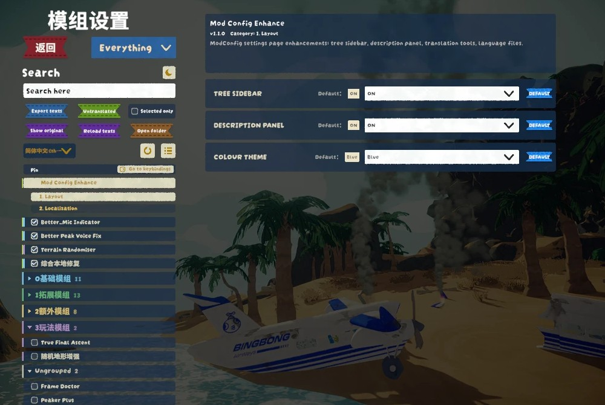
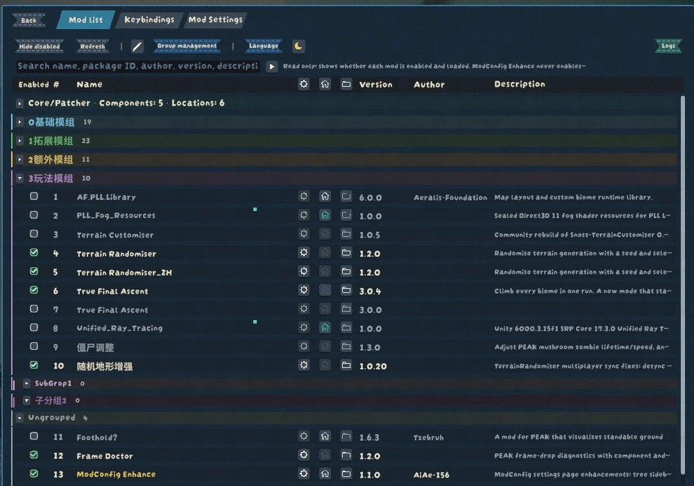
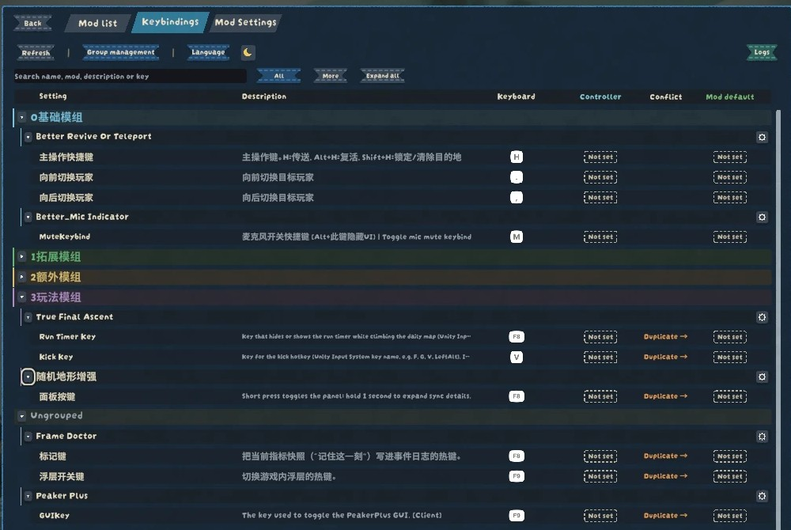
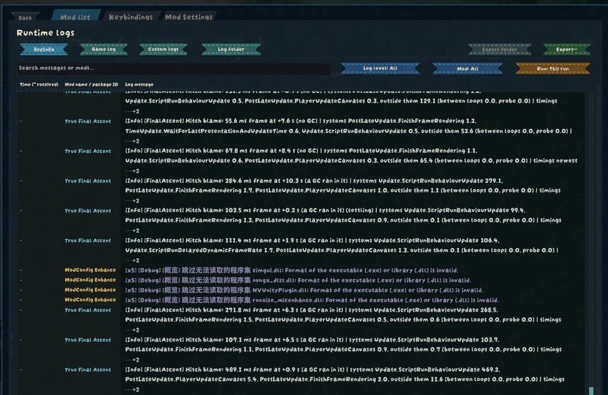
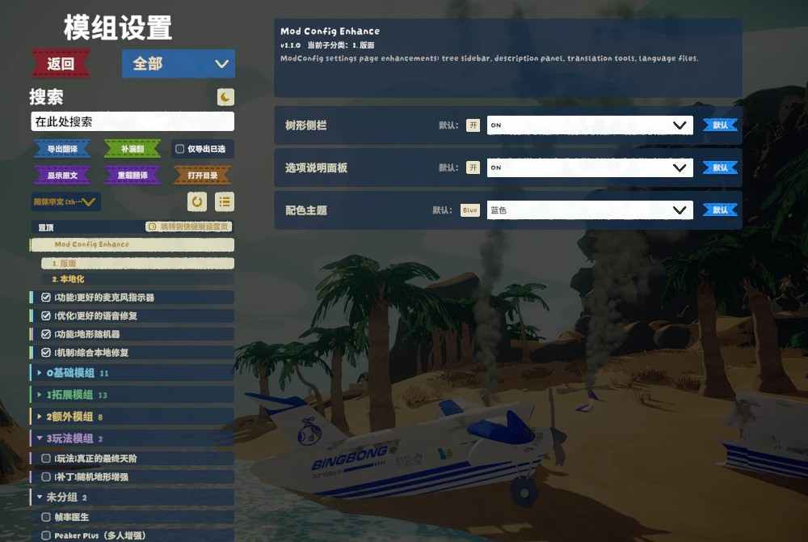
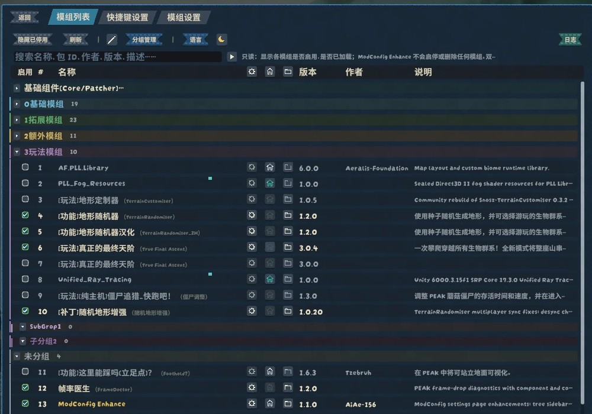
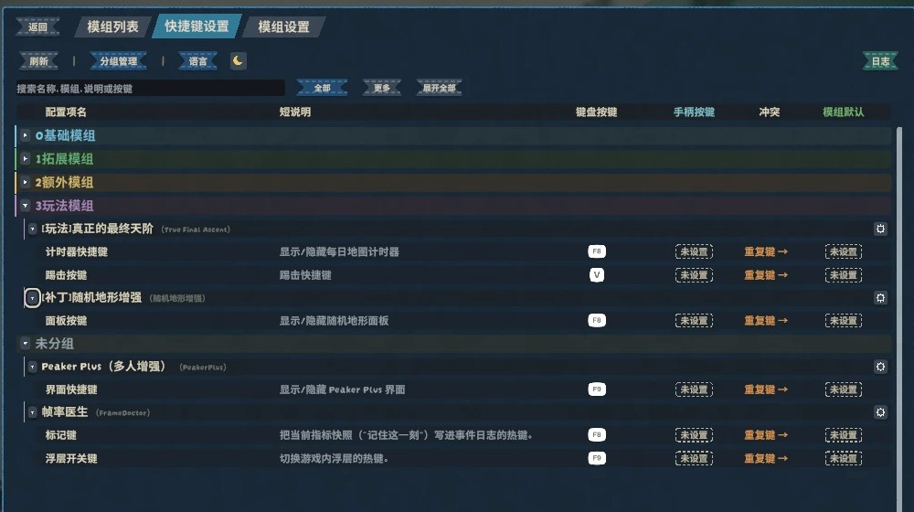
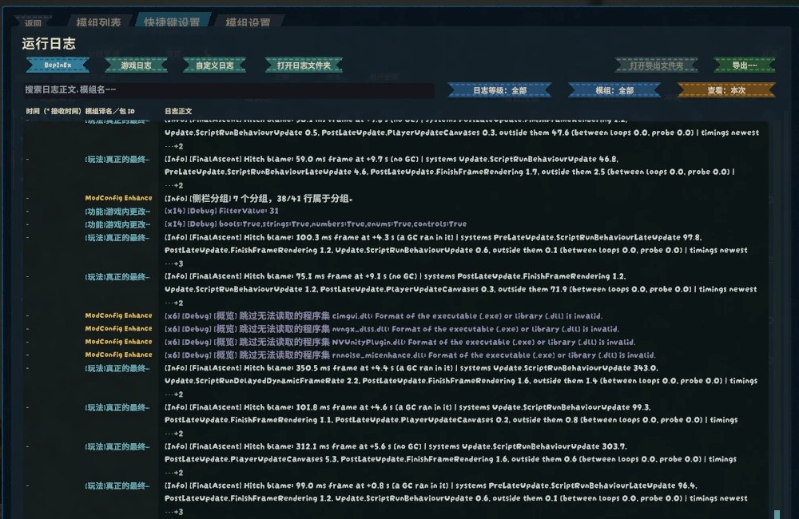

<a id="english"></a>

<div align="center">

# ModConfig Enhance

PEAK · enhancements for the ModConfig (PEAKLib.ModConfig) settings page

[](https://github.com/AiAe-156/Peak-ModConfigEnhance/blob/master/CHANGELOG.md)
[](https://thunderstore.io/c/peak/)
[](https://thunderstore.io/c/peak/p/AiAe-T/ModConfigEnhance/)
[](#english)
[](https://github.com/AiAe-156/Peak-ModConfigEnhance/blob/master/LICENSE.txt)
[](https://github.com/AiAe-156/Peak-ModConfigEnhance)

**English** ｜ [中文](#中文说明) 👈

</div>

> Ever find yourself scrolling back and forth through a pile of mod settings just to change one value? Digging through cfg comments to figure out what an option does? Want to add multi-language support to your modpack? From now on, this mod lets you organize your modpack's settings far more elegantly!

**Mod overview**: every installed mod at a glance, sorted into your own groups - √  
**Keybindings**: every mod's keybinds on one page, with free-form controller combos - √  
**Log window**: built in, with filters and one-click export - √  
**Tree sidebar**: search, name sorting, pinning - √  
**Description panel**: mod name, version, option descriptions, defaults and ranges - √  
**Translation**: export untranslated texts in one click, translate freely, any number of languages, no XUnity needed - √  
**Theme**: compatible with TimeTheme's purple night theme - √  
…and other small tweaks

## ✨ At a glance

| | |
|:---:|:---:|
|  <br> **Tree sidebar & info panel** · Every mod in a tree; descriptions, defaults and ranges at a glance. |  <br> **Mod list** · Every installed mod on one page, with the full dependency chain on hover. |
|  <br> **Keybindings** · Every mod's keybinds on one page, keyboard and controller. |  <br> **Log window** · Live logs with filters, recent-launch history and ZIP export. |

## ⚙️ Settings page enhancements

- **Tree sidebar**: the left column lists mods, and the selected mod's sections expand beneath it. Search (option names, mod names, sections, config keys, descriptions), type filters and pinning.
- **Option grid**: compact rows with the default value beside each control; duplicate keybinds get a badge that jumps to the other option.
- **Description panel**: hover or select an option to see its description, default value and range; select a mod to see its name, version and summary.
- **Themes**: blue and purple, switched with the moon button; with TimeTheme installed it can turn purple at night.
- **Go to keybindings** in the header opens the keybindings page directly.

<details>
<summary>🎮 Controller on the settings page</summary>

- <kbd>A</kbd> confirms / enters; <kbd>B</kbd> steps back level by level (press <kbd>B</kbd> twice quickly to leave the page).
- <kbd>LB</kbd> / <kbd>RB</kbd> switch mods; the right stick scrolls the options.
- Sliders: press <kbd>A</kbd>, then left / right to adjust. Keybinds: press <kbd>A</kbd>, then hold the target key for 1 second to write it.
- Text boxes open the on-screen keyboard in Steam Big Picture / on Steam Deck.

</details>

## 🧭 Mod overview page

**Where**: the **Mod overview** button right below **Mod Settings** in the game's **Settings** menu. It has three tabs: **Mod list**, **Keybindings** and **Mod Settings**.

### Mod list

- Every installed mod (disabled ones too): enabled state (read-only), name, version, author and description, plus settings / homepage / folder buttons.
- Hover a mod for its full dependency chain; badges mark resource packs, nested mods, loose DLLs and duplicate copies.
- **Double-click a name or description to change it.** It is saved into the current language file and every page shows it; leave it empty to restore the original.

### Groups

- Your own display groups, up to 3 levels with colours; shared by the mod list, the keybindings page and the settings page sidebar. **Groups are for display only and never move any folder.**
- **Group management** edits names, parent groups, colours and members; right-click a group header to add a subgroup, edit or delete it.
- **With the pencil on, drag to reorder or to drop mods into a group**; with it off, dragging just scrolls. Drop a group header on the top or bottom edge of another to place it before / after that group, or on its middle to make it a subgroup.
- Subgroups are listed before a group's own mods.
- The first time you open it, groups can be built in one click from your `plugins` folder layout.

### Log window

Live BepInEx, game and custom logs; filter by level (several at once) / mod / group, search, and fold repeated errors. **Run** switches to the logs of the last 3 launches; one click exports a ZIP (no config values, personal paths removed).

### Keybindings

- Every mod's keybinds on one page, in keyboard and controller columns; **a key is written to that mod's config as soon as it is recorded**.
- Duplicate keys are flagged (including keys the game itself uses); ignore the ones you don't mind.
- Double-click a cell to write a one-line note for the current language.
- **Controller combos**: keybinds that only accept keyboard keys can still get a controller button or combo in the controller column (hold a few buttons, then press the last one; up to 4). Combos work only in game.

> ⚠️ **Heads-up**: the buttons you hold first still reach the game — only the last button is blocked.

<details>
<summary>🎮 Controller on the overview page</summary>

- ↑ / ↓ select (hold the D-pad or left stick to keep moving); <kbd>LB</kbd> / <kbd>RB</kbd> jump between toolbar buttons.
- <kbd>RT</kbd> + <kbd>LB</kbd> / <kbd>RB</kbd> move to the tab buttons, then <kbd>A</kbd> opens the tab; <kbd>RT</kbd> + ← / → page up / down; <kbd>RT</kbd> + <kbd>L3</kbd> expand / collapse all.
- <kbd>B</kbd> steps back; press <kbd>B</kbd> twice quickly to leave the page.
- Recording a controller key / combo: hold a few buttons, then press the last one (up to 4); hold <kbd>B</kbd> for 1 second to finish.

</details>

## 📦 Dependencies & compatibility

- **Required**: BepInEx 5, PEAKLib.Core, PEAKLib.UI, ModConfig 1.8.2
- **Optional**: TimeTheme (purple at night)
- **No longer needed: XUnity AutoTranslator** — this mod now does all translation itself. An endpoint that an older version emptied is not restored automatically; fill it in again yourself if you want it back.
- **Do not install together with In-Game Mod Manager**: it already contains everything this mod does. When both are installed, this mod does not load and only leaves a warning in the log.

## 📁 Files & languages

Everything this mod keeps lives in one folder and stays on this machine:

```text
BepInEx\config\ModConfigEnhance\
├─ language\              Language files: en-us.txt  zh-cn.txt  zh-tw.txt (add your own)
├─ export\                Texts written by "Export texts"
├─ overview.json          Groups, folded state, Hide disabled
├─ hotkeys.json           Ignored duplicate warnings, folded mods
├─ gamepad-combos.json    Controller combos
└─ cache\                 Log favourites, copies of the last 3 launches' logs (safe to delete)
```

**Adding a language**: click **Export texts** → put each translation to the right of the `=` → save as UTF-8 named `lowercase-code.txt` (e.g. `de-de.txt`) in `language\` → click **Refresh**, then pick it in the language dropdown.

<details>
<summary>🧰 Toolbar and translation file format</summary>

| Button | What it does |
|---|---|
| Export texts / Untranslated | Exports all / not-yet-translated texts to `export\` |
| Selected only | Exports only the mods ticked in the sidebar |
| Show original / translated | Switches between original and translated text |
| Reload texts / Refresh | Re-reads the language files / finds new languages |
| Open folder | Opens `config\ModConfigEnhance\` |

After editing a file, click **Reload texts**. Top-up translations can be saved as `de-de_extra.txt` and are merged in automatically. Same format as XUnity dictionaries: `key=translation`, `//` comments, and `r:"regex"=translation` for regex rules.

</details>

---

💬 **Feedback**: `2323086800@qq.com` / QQ group `1104320838` · GitHub: https://github.com/AiAe-156/Peak-ModConfigEnhance

---

<a id="中文说明"></a>

<div align="center">

# ModConfig Enhance

PEAK · ModConfig（PEAKLib.ModConfig）设置页增强

[](https://github.com/AiAe-156/Peak-ModConfigEnhance/blob/master/CHANGELOG.md)
[](https://thunderstore.io/c/peak/)
[](https://thunderstore.io/c/peak/p/AiAe-T/ModConfigEnhance/)
[](#中文说明)
[](https://github.com/AiAe-156/Peak-ModConfigEnhance/blob/master/LICENSE.txt)
[](https://github.com/AiAe-156/Peak-ModConfigEnhance)

[English](#english) ｜ **中文**

</div>

> 你是否经常在一堆模组配置里反复来回滑动，就为了改某一个参数;是否因为想知道某个配置项是做什么的而去config里翻注释；想为整合包添加多语言支持...从现在开始，你可以利用该模组更加优雅的整理你的整合包！

**模组概览**：已装模组一览，按自己的分组整理 - √  
**快捷键**：所有模组的快捷键集中一页设置，手柄组合键自由组合 - √  
**日志窗口**：内置，可筛选、一键导出 - √  
**树形模组栏**：搜索、名称排序、置顶 - √  
**说明面板**：显示模组名称、版本号、配置项说明、默认值与范围 - √  
**翻译**：一键导出未翻译的文本，自由翻译，支持多种语言，不再依赖 XUnity - √  
**主题**：兼容 TimeTheme 夜间幽紫主题 - √  
以及其他小改动...

## ✨ 功能一览

| | |
|:---:|:---:|
|  <br> **树形侧栏与说明面板** · 模组一棵树列完，说明、默认值、范围一眼可见。 |  <br> **模组列表** · 已装模组一页看完，悬停显示完整依赖链。 |
|  <br> **快捷键设置** · 所有模组的快捷键集中一页，键盘、手柄两栏。 |  <br> **日志窗口** · 实时日志，可筛选、看最近几次启动、导出 ZIP。 |

## ⚙️ 设置页增强

- **树形侧栏**：左栏列出模组，选中后展开分区；可搜索（选项名、模组名、分区、键名、说明）、按类型筛选、置顶。
- **选项格**：紧凑行高，控件旁显示默认值；快捷键重复时出现角标，可跳到对方。
- **说明面板**：悬停或选中时显示说明、默认值、范围；选中模组时显示名称、版本与简介。
- **主题**：蓝 / 紫两套，月亮按钮切换；装 TimeTheme 可在夜里自动换紫。
- 表头「跳转到快捷键设置页」直接进入快捷键设置页。

<details>
<summary>🎮 设置页手柄操作</summary>

- <kbd>A</kbd> 确认 / 进入，<kbd>B</kbd> 逐级返回（快速连按两次 <kbd>B</kbd> 退页）。
- <kbd>LB</kbd> / <kbd>RB</kbd> 切换模组；右摇杆滚动选项。
- 滑条：按 <kbd>A</kbd> 后左右调值；按键绑定：按 <kbd>A</kbd> 后按住目标键 1 秒写入。
- Steam 大屏幕 / Deck 下，输入框弹出屏幕键盘。

</details>

## 🧭 模组概览页

**入口**：游戏「设置」菜单里「模组设置」正下方的「模组概览」按钮，分「模组列表」「快捷键设置」「模组设置」三个页签。

### 模组列表

- 列出所有已安装的模组（含已停用的）：启用状态（只读）、名称、版本、作者、简介，以及设置 / 主页 / 文件夹按钮。
- 悬停显示完整依赖链；角标标出资源包、嵌套模组、散放 DLL 和重复副本。
- **双击名称或简介即可修改**，保存到当前语言文件，各页面同步显示；留空恢复原文。

### 分组

- 自己的显示分组，最多 3 层、可配颜色，模组列表、快捷键设置页和设置页侧栏共用。**分组只用于显示，不移动任何文件夹。**
- 「分组管理」编辑名称、上级、颜色、成员；右键分组标题可新建子分组、编辑、删除。
- **打开铅笔后按住拖动，可排序、拖进分组**；关着时拖动就是滚动。分组标题拖到另一个分组标题的上缘 / 下缘，排到它前面 / 后面；拖到中间成为它的子分组。
- 子分组排在本组模组的前面。
- 第一次打开时，可按 `plugins` 的文件夹结构一键生成分组。

### 日志窗口

实时查看 BepInEx 日志、游戏日志和自定义日志；按等级（可多选）/ 模组 / 分组筛选，可搜索、折叠重复报错。「查看」切到最近 3 次启动的历史日志；一键导出 ZIP（不含配置值，已去掉个人路径）。

### 快捷键设置

- 所有模组的快捷键集中一页，键盘 / 手柄两栏，**录完立即写入**该模组的配置。
- 重复键会标出来（包括与游戏自身操作相同的键），不在意的可以忽略。
- 双击格子，可为当前语言写一句短说明。
- **手柄组合键**：只认键盘的快捷键，也能在手柄栏录一个手柄键或组合键（先按住几个键，再按最后一个，最多 4 个）。只在游戏中生效。

> ⚠️ **注意**：先按住的键游戏仍会读到，只有最后一个键被屏蔽。

<details>
<summary>🎮 概览页手柄操作</summary>

- ↑ / ↓ 选择（按住十字键或左摇杆可连续移动）；<kbd>LB</kbd> / <kbd>RB</kbd> 在工具行按钮间跳。
- <kbd>RT</kbd> + <kbd>LB</kbd> / <kbd>RB</kbd> 移到页签按钮，再按 <kbd>A</kbd> 切换；<kbd>RT</kbd> + ← / → 翻页；<kbd>RT</kbd> + <kbd>L3</kbd> 全部展开 / 收起。
- <kbd>B</kbd> 逐级返回，快速连按两次 <kbd>B</kbd> 离开本页。
- 录制手柄键 / 组合键：先按住几个键，再按最后一个（最多 4 个）；长按 <kbd>B</kbd> 1 秒结束录制。

</details>

## 📦 依赖与兼容

- **必须**：BepInEx 5、PEAKLib.Core、PEAKLib.UI、ModConfig 1.8.2
- **可选**：TimeTheme（夜里自动换紫）
- **不再需要 XUnity AutoTranslator**：翻译已由本模组自己完成。旧版清空过的 XUnity 机翻端点不会自动恢复，需要的话请自行填回。
- **不要与 In-Game Mod Manager 同时安装**：它已包含本模组的全部功能。同时安装时本模组不加载，只在日志里留一条警告。

## 📁 文件与语言

本模组的文件都在一个文件夹里，只存在本机：

```text
BepInEx\config\ModConfigEnhance\
├─ language\              语言文件：en-us.txt  zh-cn.txt  zh-tw.txt（可自己添加）
├─ export\                「导出翻译」导出的文本
├─ overview.json          分组、折叠状态、隐藏已停用
├─ hotkeys.json           忽略的重复提示、收起的模组
├─ gamepad-combos.json    手柄组合键
└─ cache\                 日志收藏、最近 3 次启动的日志副本（可随时删除）
```

**添加语言**：点「导出翻译」→ 把译文填在 `=` 右边 → 以 UTF-8 存成 `小写语言码.txt`（如 `de-de.txt`）放进 `language\` → 点「刷新」后在语言下拉里选中。

<details>
<summary>🧰 工具行与翻译文件格式</summary>

| 按钮 | 作用 |
|---|---|
| 导出翻译 / 补漏翻 | 导出全部 / 尚未翻译的文本到 `export\` |
| 仅导出已选 | 只导出侧栏勾选的模组 |
| 显示原文 / 译文 | 在原文和译文之间切换 |
| 重载翻译 / 刷新 | 重新读取语言文件 / 发现新语言 |
| 打开目录 | 打开 `config\ModConfigEnhance\` |

改完文件点「重载翻译」生效；补翻的内容可另存为 `de-de_补充.txt`，会自动并入。格式同 XUnity 词典：`键=译文`，`//` 注释，`r:"正则"=译文` 为正则规则。

</details>

<details>
<summary>📁 个人文件（都在 <code>BepInEx\config\ModConfigEnhance\</code>，只存在本机）</summary>

| 文件 | 内容 |
|---|---|
| `overview.json` | 分组、折叠状态、隐藏已停用 |
| `hotkeys.json` | 忽略的重复提示、收起的模组 |
| `gamepad-combos.json` | 手柄组合键 |
| `cache\` | 日志收藏、最近 3 次日志副本（可随时删除） |

</details>

---

💬 **问题反馈**：`2323086800@qq.com` / QQ 群 `1104320838` · GitHub: https://github.com/AiAe-156/Peak-ModConfigEnhance
